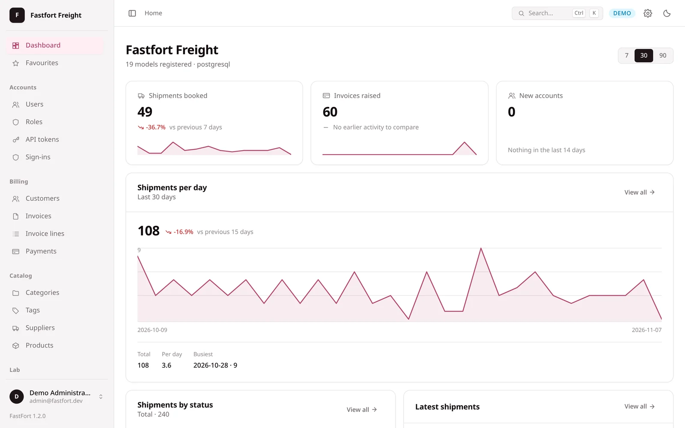
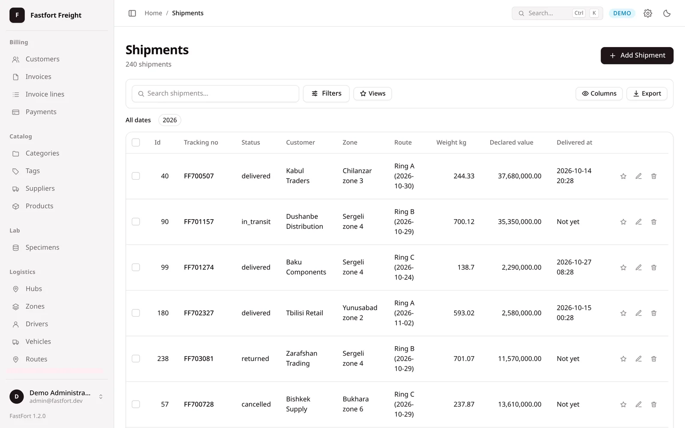
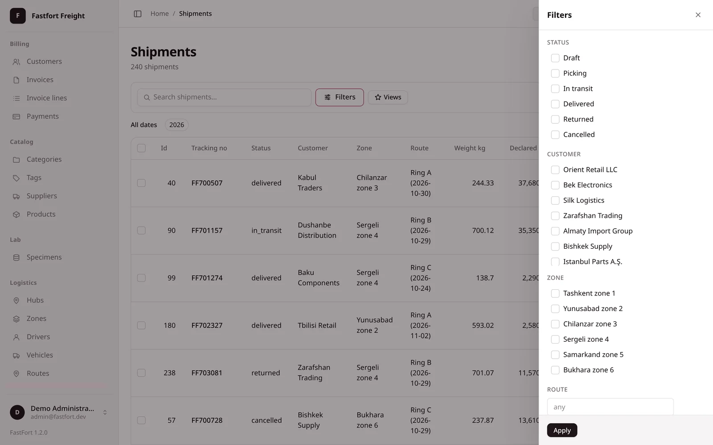
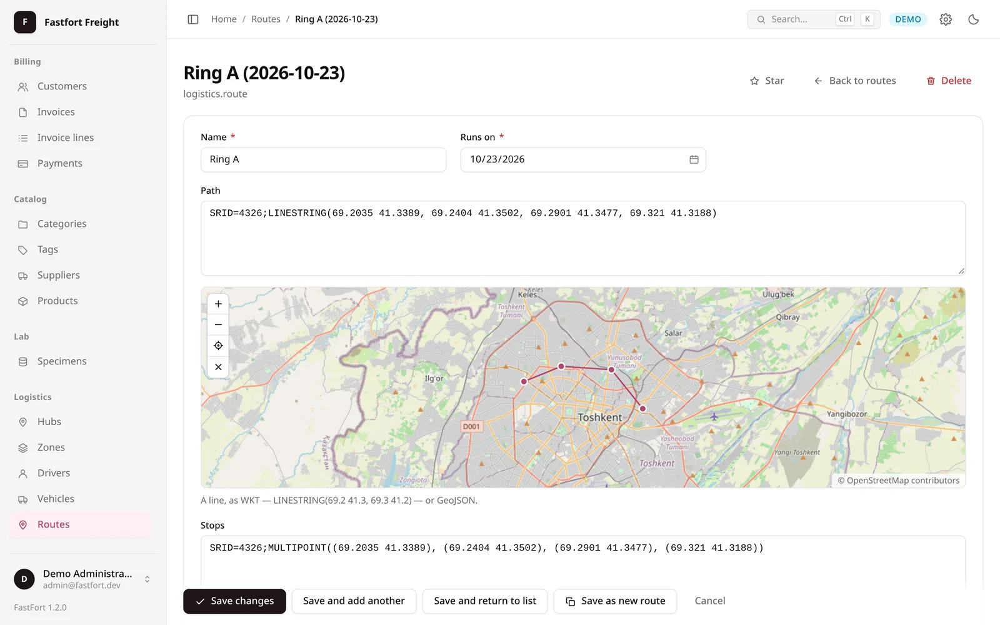
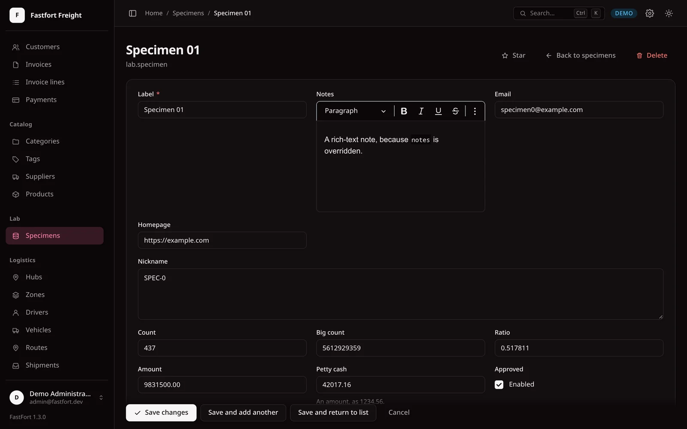
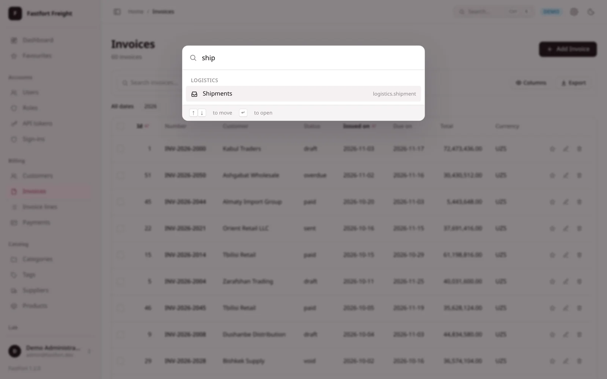
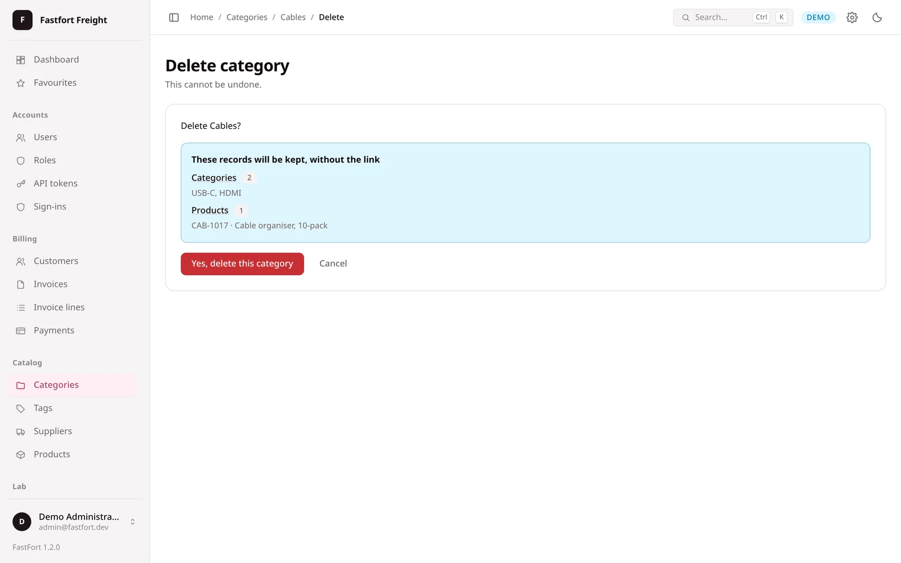
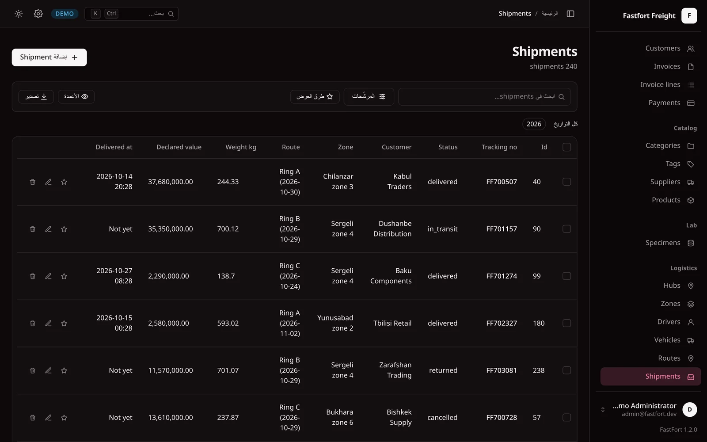
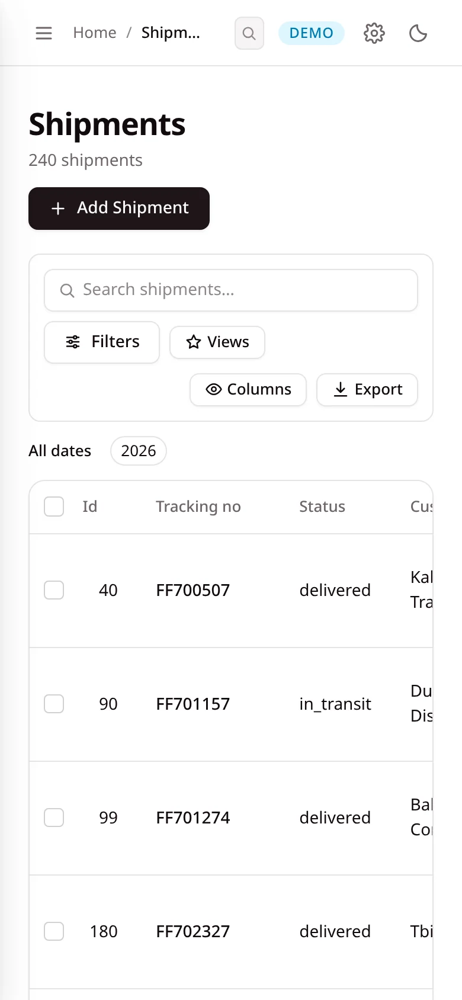

<div align="center">

# FastFort

**Batteries-included authentication and admin framework for FastAPI.**

Django-style model registration · Professional admin UI · Session + JWT auth ·
PostGIS & pgvector · SQLAlchemy & Tortoise · **No Node.js required**

[](https://github.com/Matnazar-Matnazarov/fastfort/actions/workflows/ci.yml)
[](https://pypi.org/project/fastfort/)
[](LICENSE)
[](https://www.python.org/)

[Documentation](https://docs.fastfort.inventrix.uz) ·
[Live demo](https://fastfort.inventrix.uz) ·
[Changelog](CHANGELOG.md)

<br>

<picture>
  <source media="(prefers-color-scheme: dark)" srcset="https://raw.githubusercontent.com/Matnazar-Matnazarov/fastfort/main/docs/screenshots/dashboard-dark.webp">
  
</picture>

<sub>The live demo, <a href="https://fastfort.inventrix.uz">fastfort.inventrix.uz</a> — the sign-in form is filled in for you.</sub>

</div>

> [!NOTE]
> **Stable since 1.0.** The public API follows Semantic Versioning — see
> [Versioning](#versioning). The badge above is the released version; this
> README describes `main`, which may be ahead of it.

**Contents** —
[Why FastFort?](#why-fastfort) ·
[Screenshots](#screenshots) ·
[Features](#features) ·
[Coming from Django](#coming-from-django) ·
[How it is put together](#how-it-is-put-together) ·
[Installation](#installation) ·
[Security](#security) ·
[Versioning](#versioning) ·
[Development](#development)

---

## Why FastFort?

Every FastAPI project rebuilds the same things from scratch: an admin panel, a
sign-in form, password hashing, a token endpoint, refresh rotation, CSRF, an
upload field that cannot be tricked. Django ships that. FastAPI does not.

FastFort does — for an async stack, with no build step and no Node.js. What it
does *not* ship yet is listed below, plainly, rather than left for you to find
out after installing.

```bash
uv add "fastfort[sqlalchemy]"
```

```python
# main.py
from fastapi import FastAPI
from fastfort import FastFort, FastFortSettings
from fastfort.orm.sqlalchemy import SQLAlchemyBackend

from app.db import Base, session_factory
from app.models import User

app = FastAPI()

fort = FastFort(
    settings=FastFortSettings(project_name="Shop"),
    backend=SQLAlchemyBackend(session_factory=session_factory, base=Base),
)
fort.set_user_model(User, identity_field="email")
fort.autodiscover("app")
fort.mount(app)
```

```python
# app/products/admin.py
from fastfort import admin

from app.models import Product


@admin.register(Product)
class ProductAdmin(admin.ModelAdmin):
    list_display = ("id", "name", "price", "is_active", "created_at")
    list_filter = ("is_active", "category")
    search_fields = ("name", "description")
    ordering = ("-created_at",)
    select_related = ("category",)
    icon = "box"  # drawn beside the sidebar entry

    # Offered once rows are selected. "delete" is built in; this adds another.
    actions = ("delete", "archive")

    @admin.action("Archive", icon="box")
    async def archive(self, adapter, objects):
        for product in objects:
            await adapter.update(product, {"is_active": False})
        return f"{len(objects)} products archived."
```

Create the first account and start the server:

```bash
uv run fastfort generate-secret --export      # a signing key
FF_PASSWORD=... uv run fastfort createsuperuser \
    --identity you@example.com --password-env FF_PASSWORD --no-input
uv run uvicorn main:app
```

Open `http://127.0.0.1:8000/admin`, sign in, and you have a list, a search box,
filters, sortable columns, numbered pagination, row selection with bulk actions,
and working create, edit and delete pages. Foreign keys become searchable
pickers -- backed by an autocomplete endpoint once the target table outgrows a
dropdown -- and many-to-many fields become removable chips.

None of it needs JavaScript to work. Every control is a real form input and
every sort header a real link; the browser-side code upgrades them in place and
gets out of the way when it is not there.

Field names are checked against the model when the admin is built, so a typo in
`list_display` is a start-up error naming every problem at once -- not a 500 the
first time someone opens that page.

### And a token API for the rest of your application

One setting, and the same user model and password hashes the admin uses are
behind four routes in OAuth 2's shapes:

```python
FastFortSettings(project_name="Shop", auth={"api_enabled": True})
```

```
POST /auth/token     identity + password  ->  access + refresh
POST /auth/refresh   refresh              ->  a new pair, retiring the old
POST /auth/logout    refresh              ->  204
GET  /auth/me        Bearer access        ->  who that is
```

The dependency is worth having even without the routes:

```python
from fastfort.auth import bearer_user

current_user = bearer_user(fort)


@app.get("/orders")
async def orders(user: Annotated[User, Depends(current_user)]) -> list[Order]:
    return await orders_for(user)
```

It hands your route the user **row**, and rejects an account deactivated since
the token was issued -- which a signature check alone would keep admitting until
the token expired.

---

## Screenshots

Every screen below is the [live demo](https://fastfort.inventrix.uz), a freight
company with seventeen models on PostgreSQL and PostGIS. No screen was mocked
up; each is what `pip install fastfort` renders.

<table>
  <tr>
    <td width="50%"><br><b>Lists</b> — search, sort, a <code>date_hierarchy</code> bar, per-row star, edit and delete</td>
    <td width="50%"><br><b>Filters</b> — every <code>list_filter</code> in one drawer; dates get presets and the admin's own calendar</td>
  </tr>
  <tr>
    <td><br><b>PostGIS</b> — a hand-rolled slippy map that writes WKT into the field; <i>Save as new</i> beside Django's save buttons</td>
    <td><br><b>Rich text</b> — CKEditor 5 or TinyMCE from one setting, in the admin's palette and dark mode</td>
  </tr>
  <tr>
    <td><br><b>Command palette</b> — <kbd>Ctrl</kbd> <kbd>K</kbd> to any model</td>
    <td><br><b>Deletes you can trust</b> — what cascades, what is unlinked, what blocks it</td>
  </tr>
  <tr>
    <td><br><b>Eleven languages</b> — Arabic turns the whole layout around from one attribute</td>
    <td align="center"><br><b>Phones</b> — a real mobile layout, not a shrunken desktop</td>
  </tr>
</table>

---

## Features

| | |
|---|---|
| 📊 **A dashboard you arrange** | `fort.set_dashboard(Metric(Order), Trend(Order), Breakdown(Order, on="status"), Recent(Invoice), Counts())`. Area charts, bar charts, sparklines with a signed delta, meters per value of a column — every one of them drawn by the server as SVG and boxes with a height. No charting library, no canvas, no new JavaScript, and each widget's docstring states how many queries it costs. Write your own by subclassing `Widget` |
| 🕵 **Sign-in records** | `fort.record_sign_ins(SignInRecord)` writes who signed in, from which address, on which browser and platform — failures included, because a log of successes says nothing about the night somebody tried four hundred passwords. Client hints first, user-agent second, raw string always kept. No foreign key to the user, so the row outlives the account it describes |
| 📜 **An audit log with a diff** | `fort.enable_audit_log(AuditEntry)` records every create, change and delete the admin makes — who, when, from which address, and which fields went from what to what. Diffed before-against-after, so a twenty-field form with one edit logs one change; sensitive columns never reach the table. Every record gets a *History* page, the sidebar an *Activity* feed |
| ⭐ **Favourites** | `fort.enable_favorites(Favorite)` puts a star on every row. What somebody starred collects on one page, grouped by model — the warehouse they run, the three customers in escalation |
| 🔑 **Personal access tokens** | `fort.enable_api_tokens(ApiToken)` — named, scoped, expiring, individually revocable tokens for the cron job and the integration with no password to type. Minted from the admin, shown exactly once, stored only as a digest |
| ✏️ **Editing where you are** | `inlines` edit an order's lines on the order's own page, `list_editable` edits cells in the list, `bulk_editable` sets one field across the selected rows — all in one transaction, all working with JavaScript off |
| 🛡 **Accounts a demo cannot break** | Four settings for what the admin may do to an account — change a password, change a *superuser's* password, delete an account, delete a superuser. All default to what the admin has always done. A protected password field is read-only *and* dropped from the write, because a read-only control that still accepts a posted value is a label rather than a protection |
| 🎛 **Django-style admin** | `@admin.register`, `list_display`, `list_filter`, `search_fields`, `fieldsets`, `actions`, `date_hierarchy`, `prepopulated_fields`, `save_as` — see [Coming from Django](#coming-from-django) |
| 📝 **Rich text, without bundling an editor** | `ui={"richtext_url": …, "richtext_editor": "ckeditor5"}` and every `richtext` field is CKEditor 5 (or TinyMCE), started by FastFort under its own strict CSP and drawn in the admin's palette, dark mode included. The textarea underneath stays what submits |
| 🗑 **Deletes you can trust** | The confirmation counts what actually goes: rows that cascade, rows kept with the link cleared, and rows that block the delete outright — refused with a sentence instead of a constraint violation |
| 🎨 **A UI you will not want to replace** | Light and dark themes, brand colour from a single setting, ⌘K command palette, full keyboard navigation, real mobile layout |
| 🔐 **Production-grade auth** | Argon2id hashing, session cookies invalidated by a password change, login lockout with a growing delay, CSRF on every form, and a CSP that starts at `default-src 'none'` |
| 🎫 **A token API in one setting** | `auth={"api_enabled": True}` mounts `/auth/token`, `/refresh`, `/logout` and `/me` in OAuth 2's shapes. Refresh rotation with reuse detection: a token presented twice revokes the whole family. A refresh is refused once the account is deactivated, deleted or has a new password, and no chain outlives `refresh_token_max_age`. `bearer_user(fort)` is a `Depends` for your own routes, and it hands them the user *row* |
| 🚦 **Rate limiting, on by default** | Three budgets — reads, writes, and sign-in. Argon2 is slow by design, which makes the sign-in form the cheapest thing on any site to attack, so it is charged in middleware *before* the handler and a refused request never reaches the hash |
| 📎 **Uploads that are what they say** | Extension allow-list per field kind, a deny-list checked alongside it, magic numbers checked against the name, and a `Content-Type` at serve time decided from the bytes rather than the filename. `hack.exe.png` is stored as `hack_exe.png` |
| 🗄 **Three databases** | SQLite · PostgreSQL · MySQL, with identical behaviour |
| 🔌 **Two ORMs, one admin** | SQLAlchemy 2.0 and Tortoise ORM behind one adapter contract — and a conformance suite that asks both the same questions, so "the second one behaves the same" is a test rather than a claim |
| 🧩 **Every column type** | Text, numbers, money, dates, durations, UUIDs, JSON, hstore, arrays, enums, ranges and multiranges, inet/cidr/macaddr, bit strings — each with a real control, real validation and a filter where one makes sense. `register_type` adds your own |
| 🗺 **PostGIS** | All seven geometry kinds, drawn and edited on a hand-rolled slippy map — point, line, polygon with holes, and the multi-shapes. Spatial filters: within, intersects, and "5 km from here" |
| 🧠 **Vector search** | pgvector columns ranked by similarity — `?embedding__near=[…]` with cosine, L2, L1 or inner product, a neighbour count and a distance bound |
| 🌍 **Eleven languages** | English, Uzbek, Russian, Turkish, German, French, Spanish, Chinese, Japanese, Korean and Arabic — the last of them right-to-left, which turns the whole layout around from one attribute. The catalogues ship in the package, so the admin is already translated the moment you install it — there is nothing to configure |
| ⌨️ **A CLI that matters** | `createsuperuser` so a fresh install has a way in, and `check --deploy` that exits non-zero |
| 📤 **Export and import** | The current view out as CSV, Excel or JSON — filters, search and ordering included. And back in again: the same parsers the form uses, foreign keys resolved by name or id, every bad cell reported at once with its line number, and nothing written unless the whole file parses. No openpyxl, no pandas |
| 📦 **No Node.js** | CSS and JavaScript are hand-written files inside the package, served Brotli-compressed with a gzip fallback. An ordinary page costs about 32 KB of CSS and 33 KB of script on the wire; the map and the data editors are separate files, fetched only by a page that needs them. A test weighs the lot and fails when it grows |

---

## Coming from Django

The `ModelAdmin` vocabulary is Django's, so most of an existing `admin.py`
reads the same here. What is supported, option by option:

| Django option | FastFort | Notes |
|---|---|---|
| `list_display`, `list_display_links`, `list_filter`, `search_fields`, `ordering`, `list_per_page` | ✅ | Checked against the model at start-up |
| `list_select_related` | ✅ `select_related` / `prefetch_related` | |
| `list_editable` | ✅ | One form, one transaction, works without JavaScript |
| `date_hierarchy` | ✅ | Two queries; each level is an ordinary filter URL |
| `readonly_fields`, `fieldsets`, `inlines` (`TabularInline`) | ✅ | Collapsed sections are `<details>` |
| `prepopulated_fields` | ✅ | Add form only; keeps a published slug stable |
| `save_as`, `save_on_top`, *Save and add another / continue* | ✅ | *Save as new* refused beside `inlines` |
| `empty_value_display` | ✅ | |
| `actions`, `@admin.action`, `@admin.display` | ✅ | |
| `formfield_overrides` | ✅ | Keyed by field name or by type |
| `autocomplete_fields`, `raw_id_fields` | automatic | A relation becomes a search box once its table outgrows a dropdown |
| `has_*_permission`, object-level permissions | not yet | See [Not in the box yet](#not-in-the-box-yet) |

---

## How it is put together

```
UI (Jinja2 · CSS · vanilla JS)  ─┐
Admin (ModelAdmin, forms)       ─┤
Auth (sessions, tokens, CSRF)   ─┼──►  Spec layer (immutable, JSON-serialisable)  ◄── ORM adapters
Core (settings, registry)       ─┘
```

Everything above the spec layer is ORM-agnostic, and that boundary is enforced by
tests rather than by convention. Adding a second ORM never touched the admin or
the UI — `fastfort/orm/tortoise/` was written without a change anywhere above
`fastfort/orm/`, and a conformance suite asks both backends the same questions so
that "the second one behaves the same" is a test rather than a claim.

There is no front-end framework. `ui/static/js/` is one IIFE, no modules, no
build step, and every control works with JavaScript switched off — sorting and
filtering are links, everything else is a form. The script upgrades them in
place; it never owns them.

### Not in the box yet

**Roles and permissions beyond `is_staff`/`is_superuser`** — object- and
field-level permissions are the largest gap, and on the roadmap with the one
rule they must follow: `FieldSpec.editable` becoming role-aware, never a second
flag beside it. **Two-factor sign-in** and **impersonation** are next; the
audit log impersonation depends on has shipped. See [ROADMAP.md](ROADMAP.md) for the order and the
reasoning.

The audit log records what the *admin* writes. A change your application makes
through its own session emits no admin hook, so it is not in the log — emit
`Hook.AFTER_UPDATE` yourself where that matters.

---

## Installation

```bash
uv add "fastfort[sqlalchemy,postgres]"    # SQLAlchemy on PostgreSQL
uv add "fastfort[sqlalchemy,mysql]"       # SQLAlchemy on MySQL
uv add "fastfort[sqlalchemy,sqlite]"      # SQLAlchemy on SQLite
uv add "fastfort[tortoise,postgres]"      # Tortoise on PostgreSQL
uv add "fastfort[all]"                    # everything
```

Requires Python 3.11 or newer. The ORMs are separate extras and neither is
imported at package level, so installing one never pulls in the other.

### Tortoise instead of SQLAlchemy

Four lines differ. Everything else — the settings, `@admin.register`,
`list_display`, actions, export, import — is identical, because everything else
is above the ORM layer and never sees a model:

```python
from tortoise import Tortoise
from fastfort.orm.tortoise import TortoiseBackend

await Tortoise.init(
    db_url="postgres://…",
    modules={"models": ["app.models"]},
    # Tortoise 1.1 keeps its connections in a contextvar, and an ASGI server runs
    # the lifespan in a different task from the requests. Without this flag the
    # init above is invisible to every view: start-up looks healthy and the first
    # page that touches the database is a 500. `RegisterTortoise` from
    # `tortoise.contrib.fastapi` passes it for you.
    _enable_global_fallback=True,
)

fort = FastFort(settings=FastFortSettings(...), backend=TortoiseBackend())
fort.set_user_model(User)
fort.mount(app)
```

### The map beside a geometry field

Off until you name a tile server, because turning it on means the browser
fetches images from somebody else's host — which learns roughly where your
rows are, and has terms you are agreeing to:

```python
FastFortSettings(
    ui={
        "map_tile_url": "https://tile.openstreetmap.org/{z}/{x}/{y}.png",
        "map_attribution": "© OpenStreetMap contributors",
        "map_max_zoom": 19,
        "map_center": "41.31, 69.28",
    },
)
```

The host is added to the CSP `img-src`, and only that one host, so pick a
template with a single hostname rather than `{s}` subdomains. Tiles are
requested with `Referrer-Policy: origin`: the server sees your domain, never the
admin URL. `{z}`, `{x}` and `{y}` may appear in any order.

| Source | `map_tile_url` | `map_max_zoom` |
|---|---|---|
| OpenStreetMap | `https://tile.openstreetmap.org/{z}/{x}/{y}.png` | 19 |
| OpenTopoMap | `https://tile.opentopomap.org/{z}/{x}/{y}.png` | 17 |
| Esri World Imagery | `https://server.arcgisonline.com/ArcGIS/rest/services/World_Imagery/MapServer/tile/{z}/{y}/{x}` | 19 |
| Your own server | `/tiles/{z}/{x}/{y}.png` (same origin, no CSP change) | yours |

OpenStreetMap's own servers are volunteer-run and meant for light use: a busy
deployment should use a commercial layer or its own tiles. Check a tile in the
browser rather than trusting a `200`: a refused request often answers with a
perfectly valid picture of an error — OpenStreetMap's "Access blocked", or
CARTO's "API KEY REQUIRED", which is why CARTO is no longer in this table. Each provider requires its credit line in
`map_attribution`, and has usage terms worth reading before you ship.

---

## Security

Security is the half of an admin that is not visible until it fails, so it is
tested as a feature: `tests/security/` holds a regression test for every
control below, and a fix for a reported issue lands with the test that failed
before it.

- **Sessions** — signed cookies, `HttpOnly`, `SameSite=Lax`, `Secure` by default;
  a password change signs every device out.
- **Passwords** — Argon2id, rehashed on sign-in when the parameters change;
  lockout with a growing delay; a timing-equalised path for unknown accounts.
- **Tokens** — JWT access tokens verified against exactly one configured
  algorithm; refresh rotation with family revocation on reuse, refused for a
  deactivated, deleted or re-passworded account, with an absolute chain
  lifetime. Personal access tokens stored only as a digest.
- **The browser** — CSRF on every form; a CSP starting at `default-src 'none'`
  with no inline script; open redirects refused; HTML never compressed (BREACH).
- **Data in and out** — mass assignment bounded by `FieldSpec.editable`; uploads
  typed by their bytes, not their name; CSV exports defused against formula
  injection; workbook imports refuse XML entity declarations in any encoding.
- **Deployment** — `fastfort check --deploy` exits non-zero on an unsafe
  configuration.

Found a vulnerability? Please **do not open a public issue** — see
[SECURITY.md](SECURITY.md) for how to report it privately.

---

## Versioning

FastFort follows [Semantic Versioning](https://semver.org/). From 1.0:

- **The public API** is every name in the `__all__` of `fastfort`,
  `fastfort.admin`, `fastfort.orm.sqlalchemy` and `fastfort.orm.tortoise`, the
  settings fields, the `ModelAdmin` options, the `Backend`/`ModelAdapter`
  protocols, and the `fastfort` command. Removing or changing any of it needs a
  major version; `tests/unit/test_public_names.py` fails when a name disappears.
- **Deprecation comes first.** A name that is going away keeps working for at
  least one minor release and raises a `DeprecationWarning` that says what to
  use instead.
- **Not covered:** anything with a leading underscore, template markup, CSS
  class names and the HTML structure of a page. Override templates knowing they
  can change in a minor release; the changelog says when one did.
- **The tables FastFort's mixins define** (sign-ins, tokens, favourites, the
  audit log) are versioned by `SCHEMA_VERSION`. A change to them is never in a
  patch release, and the changelog gives the migration.

---

## Development

The only prerequisite is [uv](https://docs.astral.sh/uv/). No Node.js, ever.

```bash
uv sync --all-extras          # set up the environment
uv run pytest                 # tests (SQLite)
uv run pytest --db=all        # tests against all three databases (needs Docker)
uv run ruff check .           # linting
uv run mypy fastfort          # type checking
make check                    # every gate at once
```

Two scratch applications come with the repository, and they are the fastest way
to see any of this working:

```bash
make sandbox              # test_api/ on PostgreSQL — every column type,
                          #   PostGIS geometry, pgvector, on :8000
make sandbox-tortoise     # test_api_tortoise/ on SQLite — a different schema,
                          #   the same admin, on :8001
```

Open them side by side. The models, the ORM and the database all differ; the
admin does not, which is the whole of what the layering buys.

See [CONTRIBUTING.md](CONTRIBUTING.md) before opening a pull request, and
[SECURITY.md](SECURITY.md) to report a vulnerability.

---

## License

[MIT](LICENSE) © Matnazar
